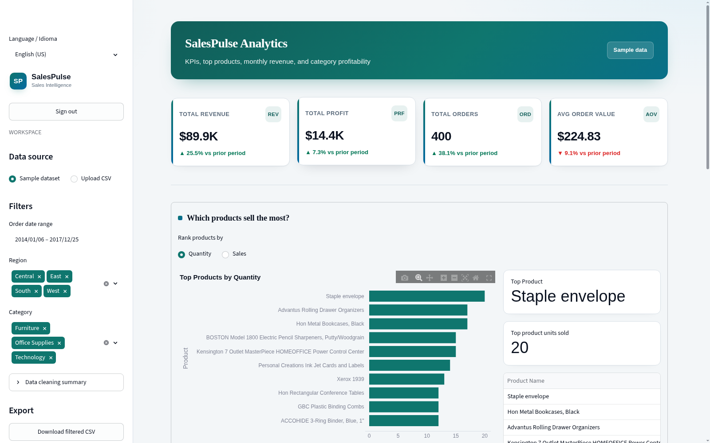

<div align="center">

# SalesPulse Analytics

**A client-ready sales intelligence dashboard built with Streamlit.**

[](https://www.python.org/)
[](https://streamlit.io/)
[](#development)

Turn CSV sales data into decision-ready KPIs, trends, product rankings, and exportable reports—available in English and Português-BR.

</div>



## Overview

SalesPulse provides a secure, polished workspace for exploring a bundled sample dataset or a client-supplied CSV. Filter performance by date, region, and category, then export the exact view as CSV or a multi-sheet Excel workbook.

## Features

- **Password gate** — workspace password via Streamlit secrets
- **Data sources** — bundled sample dataset or client CSV upload with schema validation
- **KPIs** — revenue, profit, orders, average order value with period-over-period deltas
- **Charts** — top products, monthly revenue, category profit and margin
- **Filters** — order date, region, category
- **Export** — filtered CSV and multi-sheet Excel report
- **i18n** — English (US) / Português (BR), locale-aware currency (`$` / `R$`)

## Requirements

- Python 3.10+
- Dependencies in `requirements.txt` (pandas, streamlit, plotly, openpyxl)

## Quick start

```bash
python -m venv .venv
source .venv/bin/activate   # Windows: .venv\Scripts\activate
pip install -r requirements.txt
```

Configure the workspace password:

```bash
cp .streamlit/secrets.toml.example .streamlit/secrets.toml
# edit app_password
```

## Run

```bash
streamlit run app.py
```

Open `http://localhost:8501`, sign in with the password from secrets, then explore the sample data or upload a CSV.

> [!TIP]
> Use the bundled sample dataset to explore the full dashboard immediately—no external data source is required.

## CSV schema

**Required columns**

| Column | Notes |
|--------|--------|
| Order ID | Unique order identifier |
| Order Date | Parseable date |
| Product Name | Product label |
| Category | Category label |
| Sales | Numeric |
| Profit | Numeric |
| Quantity | Numeric |

**Optional columns:** Region (defaults to `All`), Sub-Category (defaults to `Unknown`), Ship Date, Discount.

A bundled sample lives at `data/sample_superstore.csv` (committed). A full local Superstore dump at `data/superstore.csv` remains gitignored.

## Docker

```bash
docker build -t salespulse .
docker run --rm -p 8501:8501 \
  -v "$(pwd)/.streamlit/secrets.toml:/app/.streamlit/secrets.toml:ro" \
  salespulse
```

## Streamlit Community Cloud

1. Push this repo to GitHub.
2. Create an app pointing at `app.py`.
3. Under **Settings → Secrets**, add:

```toml
app_password = "your-strong-password"
```

## Development

```bash
pip install -r requirements-dev.txt
pytest
```

## Project structure

```
app.py                         # UI: auth, data source, filters, charts, export
src/auth.py                    # Password gate
src/data_loader.py             # CSV load, validate, clean
src/export.py                  # CSV / Excel builders
src/kpis.py                    # Aggregations
src/charts.py                  # Plotly builders
src/styles.py                  # Design system
src/i18n.py                    # en / pt-BR strings
data/sample_superstore.csv     # Bundled sample
.streamlit/config.toml         # Theme
.streamlit/secrets.toml.example
Dockerfile
requirements.txt
requirements-dev.txt
tests/
```
